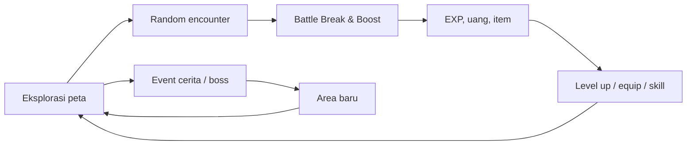
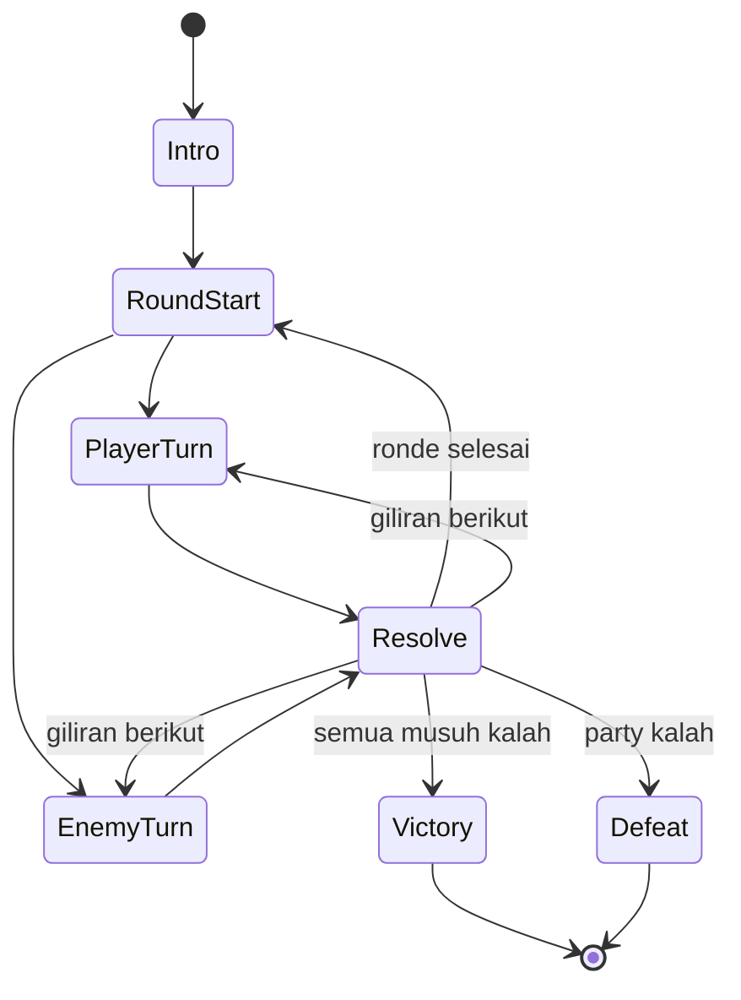
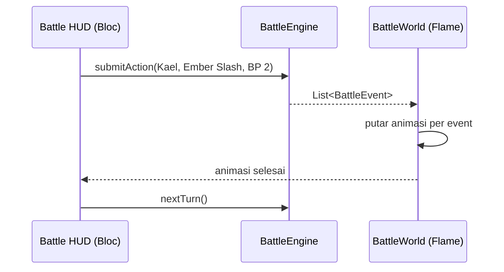

# Legend Heroes — Chapter 1: Ashen Crest — Game Spec & Plan

Sep 24, 2026 · @fian

## Ringkasan

Legend Heroes adalah JRPG pixel art bergaya HD-2D untuk Android & iOS. Chapter 1 berjudul *Ashen Crest*. Chapter 1 berdurasi 1–2 jam dengan battle turn-based ala Octopath (Break & Boost). Engine: Flutter + Flame, peta dibuat di Tiled, dan game berjalan full offline.

| Keputusan | Pilihan |
| --- | --- |
| Scope | Chapter 1, target 75–110 menit main |
| Party | Kael (hero) dan Lira (support), plus 1 karakter tamu sementara di tambang; sistem rekrut karakter menyusul di chapter berikutnya |
| Battle | Turn-based, shield + weakness, Break, Boost Point (BP) |
| Platform | Android 8+ dan iOS 15+, orientasi landscape |
| Monetisasi | Gratis penuh: tanpa iklan dan tanpa IAP |
| Bahasa | Indonesia dan Inggris sejak awal (string terpisah) |

**Pilar desain**

1. **Battle yang bikin mikir.** Setiap musuh punya teka-teki kecil: cari weakness, hancurkan shield, lalu Boost di momen yang tepat.
2. **Cerita hangat dua sahabat.** Hubungan Kael dan Lira jadi jantung cerita, bukan sekadar menyelamatkan dunia.
3. **Mobile-first.** Sesi main 10–15 menit, auto-save, kontrol sentuh yang nyaman dan tombol besar.

## Konsep & cerita chapter 1

Premis: Ashen Crest, bara suci di kuil desa Hollowmere, retak dalam semalam. Sejak itu hutan sekitar desa dipenuhi monster yang terkena Ashblight. Kael dan Lira berangkat mencari pecahan Crest yang hilang.

**Karakter**

- **Kael (19)** — penjaga muda desa, pendekar pedang. Keras kepala dan protektif, tapi diam-diam ragu apakah dirinya cukup kuat.
- **Lira (18)** — teman masa kecil Kael, murid tabib desa. Ceria dan tenang di bawah tekanan. Chapter 1 menanam petunjuk bahwa Lira punya hubungan dengan api Crest.
- **Seren (22)** — karakter tamu. Pemburu relik yang juga mengejar pecahan Crest. Sinis, cekatan, dan selalu selangkah di depan. Ia muncul sebagai rival di tambang, bekerja sama melawan Ironhide Mole, ikut sampai Cinder Warden, lalu pergi mengejar sosok berjubah. Ia bisa direkrut kembali di chapter berikutnya.

**Alur beat cerita**

| # | Beat | Lokasi | Durasi |
| --- | --- | --- | --- |
| 1 | Prolog: festival bara, Crest retak, serangan pertama (tutorial battle) | Hollowmere | 10 menit |
| 2 | Tetua desa meminta Kael mencari pecahan; Lira memaksa ikut | Hollowmere | 5 menit |
| 3 | Perjalanan menembus hutan, tutorial weakness & Break | Whisperwood | 20 menit |
| 4 | Bertemu pedagang yang terluka, side quest opsional | Pos Whisperwood | 10 menit |
| 5 | Tambang tua: puzzle tuas, bertemu Seren di lantai 2 (ia bergabung sementara), mini-boss, tutorial Boost | Old Emberline Mine | 25 menit |
| 6 | Boss: Cinder Warden menjaga pecahan Crest | Mine Depths | 10 menit |
| 7 | Lira menyentuh pecahan dan bara menyala di tangannya; sosok berjubah mengamati, Seren pergi mengejarnya | Mine Depths | 5 menit |
| 8 | Kembali ke desa, Crest pulih sebagian, hook chapter 2 | Hollowmere | 5 menit |

Total sekitar 90 menit termasuk side quest di beat 4; grinding dan eksplorasi ekstra menambah 10–20 menit.

## Core loop & eksplorasi

Pemain menjelajah peta, memicu battle, mendapat EXP dan item, lalu menjadi cukup kuat untuk area dan boss berikutnya.



Loop kecil (eksplor → battle → upgrade) berjalan terus; loop besar maju lewat event cerita dan boss.

**Eksplorasi**

- **Gerak bebas** di peta top-down 3/4 (bukan grid), kecepatan jalan 120 px/detik dan lari 200 px/detik.
- **Encounter acak** berbasis jarak tempuh, dengan indikator bahaya (hijau/kuning/merah) di pojok layar. Ada jeda aman 3 detik setelah battle.
- **Interaksi**: bicara ke NPC, buka peti, periksa objek, dan pindah area lewat pintu atau tepi peta.
- **Path action Lira: "Tanya"** — bisa dipakai ke NPC tertentu untuk membuka info rahasia, lokasi peti tersembunyi, atau diskon toko. Ini penghormatan kecil ke path action Octopath.
- **Path action Seren: "Curi"** — selama Seren ikut, pemain bisa mencoba mencuri item dari NPC tertentu (peluang berdasarkan level). Gagal menurunkan reputasi di tambang, jadi NPC tersebut tidak bisa dicoba lagi.
- **Save**: api unggun (save manual + pulihkan HP/SP) dan auto-save setiap pindah area.

**Kontrol mobile (landscape)**

| Area layar | Fungsi |
| --- | --- |
| Setengah kiri | Joystick virtual melayang (muncul di titik sentuh) |
| Kanan bawah | Tombol Aksi (bicara/periksa) dan tombol Lari |
| Kanan atas | Tombol Menu (party, item, equip, save) |
| Saat dialog | Tap di mana saja untuk lanjut, tahan untuk mempercepat teks |

Dukungan gamepad Bluetooth masuk backlog, bukan chapter 1.

## Sistem battle Break & Boost

Battle turn-based per ronde: pemain mengincar weakness untuk menghabiskan shield musuh, membuat musuh Break, lalu menumpahkan Boost Point untuk damage besar.

**Urutan giliran**

- Urutan tiap ronde diurutkan dari SPD × acak 0,9–1,1.
- Timeline di atas layar menampilkan urutan ronde ini dan ronde berikutnya.
- Aksi "Tahan" memberi prioritas di awal ronde berikutnya.

**Shield & weakness**

- Setiap musuh punya shield (2–4 untuk musuh biasa, 6–10 untuk boss) dan 2–4 weakness.
- Weakness tampil sebagai ikon "?" dan terbuka permanen (disimpan di bestiary) setelah pertama kali dikenai.
- Tipe serangan (9): Pedang, Tombak, Tongkat, Belati, Api, Es, Petir, Angin, Cahaya.
- Setiap hit yang mengenai weakness mengurangi 1 shield. Serangan multi-hit mengurangi shield sekali per hit.

**Break**

- Shield 0 membuat musuh Break: kehilangan giliran ronde ini (jika belum bergerak) dan ronde berikutnya.
- Musuh yang Break menerima damage ×2.
- Setelah pulih, shield kembali penuh.

**Boost Point (BP)**

| Aturan | Nilai |
| --- | --- |
| BP awal battle | 1 |
| Tambahan BP | +1 di awal giliran karakter, kecuali giliran saat ia memakai Boost |
| BP maksimum | 5 |
| Boost per aksi | 0–3 BP |
| Serangan biasa | Jumlah hit = 1 + BP dipakai |
| Skill | Pengali power: 0 BP ×1,0 · 1 BP ×1,6 · 2 BP ×2,2 · 3 BP ×3,0 |

**Menu aksi**: Serang, Skill (pakai SP), Item, Tahan (damage diterima −50%), dan Kabur (peluang 60% base, tidak bisa di boss).

**Formula damage**

```latex
\text{Dmg} = \max\left(1,\ \text{ATK}\cdot P - \tfrac{\text{DEF}}{2}\right) \cdot R \cdot W \cdot B
```

P = power skill atau boost, R = acak 0,95–1,05, W = 1,3 jika weakness, dan B = 2,0 jika musuh sedang Break. Skill elemen memakai EATK dan EDEF sebagai pengganti ATK dan DEF.

**Alur state battle**



`Resolve` menangani damage, pengurangan shield, cek Break, status effect, dan animasi sebelum giliran berikutnya.

**Aturan boss**: boss bisa bertindak 2 kali per ronde, dan memasuki fase 2 di HP 50% (pola baru serta weakness bergeser).

## Karakter, stats & progression

Kael adalah damage dealer dan tank yang menjaga Lira; Lira adalah healer yang juga membuka weakness elemen dan mengalirkan BP ke Kael. Seren (tamu) adalah debuffer cepat yang membuka jalan untuk Break: ia melemahkan pertahanan musuh dan menghancurkan shield dengan serangan multi-hit. Level cap chapter 1 adalah 15.

**Stats level 1**

| Karakter | HP | SP | ATK | DEF | EATK | EDEF | SPD | Senjata | Elemen |
| --- | --- | --- | --- | --- | --- | --- | --- | --- | --- |
| Kael | 220 | 40 | 34 | 28 | 18 | 18 | 24 | Pedang, Tombak | Api, Petir |
| Lira | 170 | 70 | 22 | 20 | 32 | 30 | 28 | Tongkat, Belati | Es, Angin, Cahaya |
| Seren (tamu) | 190 | 55 | 30 | 22 | 26 | 24 | 34 | Belati | Angin, Es |

Seren bergabung dengan level yang sama dengan Kael saat itu (target 9–10).

Pertumbuhan per level sekitar +7% HP dan +5% stat lain, dengan tabel pertumbuhan per karakter di data JSON.

**Skill Kael**

| Lv | Skill | SP | Efek |
| --- | --- | --- | --- |
| 1 | Ember Slash | 8 | Pedang + Api, 1 musuh, power 1,5 |
| 3 | Cross Thrust | 10 | Tombak, 1 musuh, 2 hit × 0,8 (penghancur shield) |
| 6 | Thunder Edge | 14 | Petir, semua musuh, power 1,2 |
| 9 | Rally Guard | 12 | Provokasi + DEF +30% selama 2 giliran |
| 13 | Crest Breaker | 24 | Pedang, 1 musuh, 3 hit × 1,0 |

**Skill Lira**

| Lv | Skill | SP | Efek |
| --- | --- | --- | --- |
| 1 | Heal | 6 | Pulihkan 1 ally (berbasis EATK) |
| 1 | Frost Needle | 7 | Es, 1 musuh, power 1,3 |
| 4 | Gale Dance | 12 | Angin, 2 hit ke musuh acak |
| 7 | Light Ward | 10 | EDEF party +30% selama 3 giliran |
| 11 | Radiant Bloom | 22 | Cahaya, semua musuh, power 1,4 |
| 14 | Kindle | 16 | Beri 1 BP ke ally lain |

**Skill Seren (tamu)**

| Lv | Skill | SP | Efek |
| --- | --- | --- | --- |
| 1 | Shadow Stab | 6 | Belati, 1 musuh, 2 hit × 0,7 (penghancur shield) |
| 1 | Rend Armor | 8 | DEF 1 musuh −30% selama 3 giliran |
| 5 | Gale Cut | 11 | Angin, semua musuh, power 1,0 |
| 8 | Hex Mark | 9 | EDEF 1 musuh −30% selama 3 giliran |
| 10 | Rime Flurry | 14 | Es, 1 musuh, 3 hit × 0,6 |
| 12 | Pilfer | 5 | Serang 1 musuh dan peluang mencuri item |

**Progression**

- EXP ke level berikutnya: 20 × L^1,8 (Lv 1→2 = 20 EXP, Lv 10→11 ≈ 1.260 EXP).
- Slot equipment: Senjata, Armor, Aksesori. Chapter 1 berisi sekitar 8 senjata, 6 armor, dan 5 aksesori.
- Item konsumsi: Herbal (pulihkan HP), Tonik (pulihkan SP), Bulu Bara (hidupkan kembali dengan 50% HP), Penawar (hapus racun).
- Mata uang: Keping. Toko ada di Hollowmere dan Pos Whisperwood.

## Konten chapter

Chapter 1 terdiri dari 8 peta, 8 jenis musuh biasa, 1 mini-boss, dan 1 boss. Target level party saat boss adalah 10–12.

**Area**

| Area | Jumlah peta | Isi utama | Encounter |
| --- | --- | --- | --- |
| Hollowmere | 2 (desa + kuil) | NPC, toko, tetua, api unggun | Tidak ada |
| Whisperwood | 2 | Jalur hutan, 4 peti, 1 peti tersembunyi (via "Tanya") | Rendah → sedang |
| Pos Whisperwood | 1 | Pedagang, side quest, api unggun | Tidak ada |
| Old Emberline Mine | 2 lantai | Puzzle tuas, mini-boss, 5 peti | Sedang → tinggi |
| Mine Depths | 1 | Arena boss, event pecahan Crest | Tidak ada |

**Musuh**

| Musuh | Area | HP | Shield | Weakness |
| --- | --- | --- | --- | --- |
| Ashen Rat | Whisperwood | 90 | 2 | Belati, Api |
| Wisp Moth | Whisperwood | 80 | 2 | Angin, Cahaya |
| Blight Sprout | Whisperwood | 120 | 3 | Pedang, Api, Angin |
| Moss Wolf | Whisperwood | 160 | 3 | Tombak, Api |
| Cave Bat | Mine | 110 | 3 | Belati, Angin |
| Cinder Imp | Mine | 200 | 3 | Tombak, Es, Angin |
| Ember Slime | Mine | 180 | 4 | Tongkat, Es |
| Rustbone Miner | Mine | 240 | 4 | Tongkat, Petir, Cahaya |
| Ironhide Mole (mini-boss) | Mine lantai 2 | 1.400 | 6 | Tombak, Petir, Es |
| Cinder Warden (boss) | Mine Depths | 4.500 | 8 → 10 | Fase 1: Pedang, Es, Cahaya · Fase 2: Tombak, Angin, Cahaya |

**Side quest**: Pedagang di Pos Whisperwood meminta 3 Herbal Bara dari Whisperwood. Hadiahnya aksesori "Jimat Hangat" (tahan Api +20%).

## Arsitektur teknis

Logika game (battle, stats, inventory) ditulis sebagai Dart murni di layer domain, tanpa dependensi Flame. Flame hanya merender dunia dan animasi, sedangkan UI menu, dialog, dan HUD dibuat sebagai Flutter overlay yang dikelola Bloc.

**Package utama**

| Package | Fungsi |
| --- | --- |
| flame | Game loop, komponen, sprite animation, camera |
| flame\_tiled | Load peta .tmx dari Tiled (layer, collision, spawn point, trigger) |
| flame\_audio | BGM dan SFX |
| jenny | Skrip dialog format Yarn Spinner |
| flutter\_bloc | State UI overlay (menu, dialog, battle HUD) |
| path\_provider | Lokasi file save JSON |

**Struktur folder**

```
lib/
  core/          # konstanta, DI, lokalisasi, config tuning
  data/          # loader JSON, SaveRepository
  domain/        # entity (Character, Enemy, Skill, Item)
    battle/      # BattleEngine, TurnQueue, DamageCalculator
  game/          # AshenCrestGame (FlameGame)
    overworld/   # peta, player, NPC, chest, trigger
    battle/      # BattleWorld, sprite musuh, efek
  presentation/  # overlay Flutter + Bloc
assets/
  data/          # enemies.json, skills.json, items.json, encounters.json
  dialog/        # *.yarn
  maps/          # *.tmx, tileset
  images/        # sprite sheet, UI, efek
  audio/
```

**Alur battle engine → tampilan**



Engine mengembalikan daftar event (DamageDealt, ShieldReduced, BreakStarted, UnitDefeated), lalu Flame memutarnya berurutan. Dengan pola ini battle engine bisa diuji penuh lewat unit test tanpa merender apa pun.

**Perpindahan scene**: RouterComponent Flame untuk Overworld ↔ Battle ↔ Cutscene. Posisi dan state peta disimpan sebelum masuk battle lalu dipulihkan setelahnya.

**Save system**: 3 slot manual + 1 slot auto-save berupa file JSON di folder dokumen aplikasi. Setiap file punya field `saveVersion` untuk migrasi, dan isinya mencakup party, inventory, flag cerita, peti yang sudah dibuka, dan bestiary.

**Target performa**

- 60 fps di Android kelas menengah (RAM 4 GB) dan iPhone 11 ke atas.
- Ukuran install di bawah 80 MB.
- Cold start di bawah 3 detik.
- Render pixel art dengan `FilterQuality.none` dan resolusi virtual 480×270 yang di-scale bulat (integer scaling).

## Art & audio pipeline

Tampilan ala HD-2D dibangun dari lapisan dan cahaya, bukan dari sprite saja. Semua efek berat bisa dimatikan lewat opsi grafis Rendah/Tinggi untuk HP kelas bawah.

**Teknik HD-2D di Flame**

- **Layering dan y-sort**: background parallax, layer tile, sprite yang diurutkan berdasarkan posisi Y, lalu layer foreground (daun, atap) di atas karakter.
- **Depth of field murah**: layer latar jauh dan foreground diblur sebelumnya di editor, jadi tidak ada blur real-time.
- **Cahaya**: overlay gelap dengan blend multiply, ditambah sprite glow additive untuk obor, api unggun, dan kristal di tambang.
- **Bayangan**: elips semi-transparan di bawah setiap karakter dan musuh.
- **Partikel**: bara melayang di desa, debu di tambang, daun di hutan.
- **Bloom dan vignette**: fragment shader opsional, hanya aktif di mode grafis Tinggi.

**Spesifikasi sprite**

- Overworld: 32×48 px per frame, 4 arah, idle 2 frame dan walk 4 frame (format sheet yang sudah dibuat).
- Battle: 48×48 px, menghadap samping, dengan animasi idle, serang, skill, kena hit, dan KO.
- Tile: 16×16 px, palet terbatas per area supaya warna konsisten.

**Daftar asset**

| Asset | Jumlah | Status |
| --- | --- | --- |
| Sprite overworld Kael & Lira | 2 sheet | Selesai |
| Sprite battle Kael & Lira | 2 sheet (5 animasi) | Belum mulai |
| Sprite overworld & battle Seren | 2 sheet | Belum mulai |
| Portrait dialog Seren | 4 ekspresi | Belum mulai |
| Portrait dialog | 2 karakter × 4 ekspresi | Belum mulai |
| Sprite NPC overworld | 8 | Belum mulai |
| Sprite battle musuh | 10 (termasuk mini-boss & boss) | Belum mulai |
| Tileset (desa, hutan, tambang) | 3 | Belum mulai |
| UI (window, ikon weakness, BP, tombol) | 1 set | Belum mulai |
| Efek skill dan partikel | ±15 | Belum mulai |
| BGM (desa, hutan, tambang, battle, boss, tema) | 6 track | Belum mulai |
| SFX | ±30 | Belum mulai |

Musik (6 track BGM) dibuat oleh Claude. SFX boleh memakai sumber CC0 atau royalty-free.

## Plan & milestone

Estimasi total 17 minggu, dengan asumsi dikerjakan solo sekitar 10–15 jam per minggu dan mulai 5 Oktober 2026. Dengan asumsi itu, target rilis adalah Jan 31, 2027.

| Milestone | Minggu | Deliverable | Selesai jika |
| --- | --- | --- | --- |
| M0 Setup | 1 | Repo, struktur folder, CI build Android/iOS, karakter bisa jalan di peta kosong | Build jalan di HP fisik |
| M1 Prototype battle | 2–4 | BattleEngine Dart murni (turn queue, damage, shield, Break, BP) + scene battle placeholder | Unit test lolos, 1 battle lawan 3 musuh bisa dimainkan |
| M2 Overworld & sistem | 5–7 | Peta Tiled, collision, dialog jenny, encounter, transisi scene, menu, inventory, save/load | Bisa jalan, battle, save, lalu load kembali |
| M3 Vertical slice | 8–9 | Whisperwood lengkap dengan 4 musuh, art final, cahaya dasar | 3–5 orang playtest 15 menit tanpa bantuan |
| M4 Produksi konten | 10–13 | Semua peta, musuh, mini-boss, boss, cutscene, side quest | Chapter tamat dari awal sampai akhir |
| M5 Polish | 14–15 | Efek HD-2D, audio, balancing, lokalisasi ID/EN | Durasi playtest 75–110 menit, tidak ada battle yang terasa buntu |
| M6 QA & rilis | 16–17 | Uji perangkat, optimasi, aset store, internal testing & TestFlight | Lolos review Play Store dan App Store |

**Prioritas kalau waktu mepet** (dipotong dari bawah): bloom shader, side quest, peta kedua Whisperwood, lalu jumlah jenis musuh (8 → 6). Battle system dan boss tidak dipotong.

## Risiko & open questions

Risiko terbesar adalah volume produksi art, bukan kode. Karena itu vertical slice di M3 menjadi titik keputusan untuk memangkas atau melanjutkan scope.

| Risiko | Dampak | Mitigasi |
| --- | --- | --- |
| Produksi art (musuh, tileset, animasi battle) memakan waktu jauh lebih lama | Jadwal M4 molor 2–4 minggu | Kunci palet dan ukuran sprite sejak M0; pakai tileset berlisensi sebagai dasar |
| Battle terasa repetitif atau terlalu mudah dengan 2 karakter | Pemain bosan sebelum boss | Setiap area menambah 1 mekanik (weakness baru, musuh buff, boss 2 fase); playtest di M3 |
| Efek cahaya dan shader berat di Android kelas bawah | FPS turun, HP panas | Opsi grafis Rendah/Tinggi; profiling di perangkat nyata sejak M2 |
| Scope creep (fitur ekstra, chapter 2) | Chapter 1 tidak pernah rilis | Cut list di bagian Plan; fitur baru masuk backlog chapter 2 |
| Review App Store / signing iOS | Rilis iOS tertunda | Upload TestFlight sejak M3, bukan di akhir |

**Keputusan (sebelumnya open questions, dijawab Sep 24, 2026)**

- [x] Judul final game: **Legend Heroes**. *Ashen Crest* tetap dipakai sebagai nama bara suci dan judul Chapter 1.
- [x] Karakter tamu ketiga: **ada**, yaitu **Seren** (pemburu relik, debuffer), ikut sementara di Old Emberline Mine. Chapter berikutnya akan punya sistem rekrut karakter, jadi party dan data karakter harus mendukung lebih dari 2 anggota.
- [ ] Art final: masih terbuka. Musik: dibuat oleh Claude (lihat catatan audio).
- [x] Model rilis: **gratis penuh**, tanpa iklan dan tanpa IAP.
- [x] Resolusi virtual: **480×270**, tetap.

**Masih terbuka**

- [ ] Siapa yang membuat art final (sprite battle, tileset, portrait, UI).
