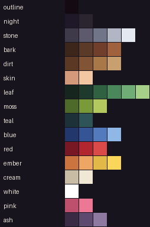
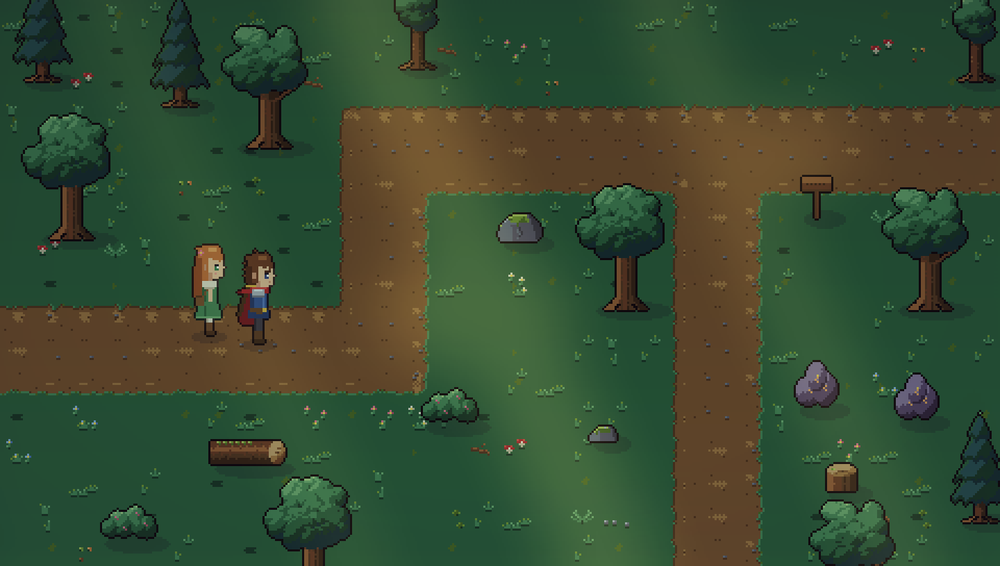
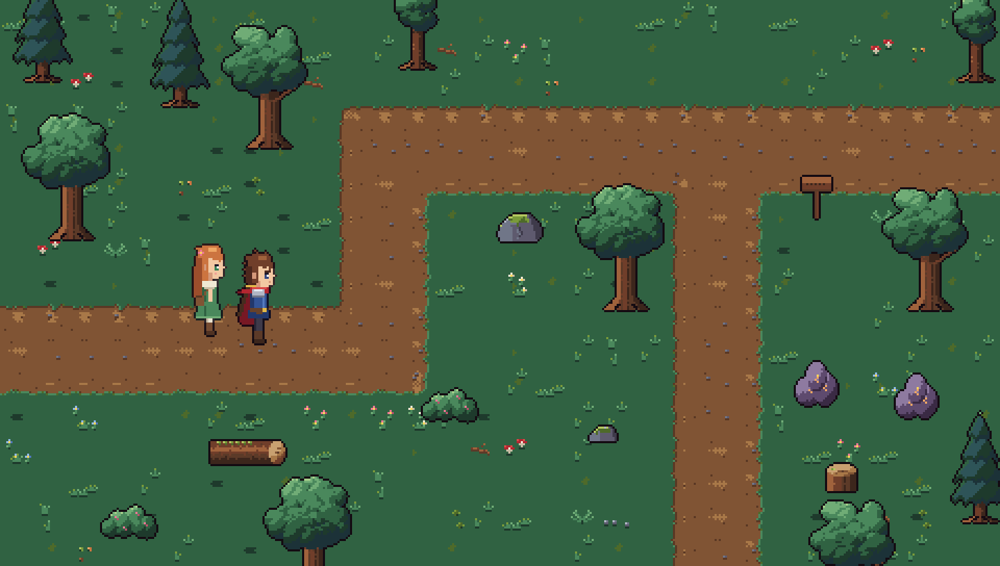
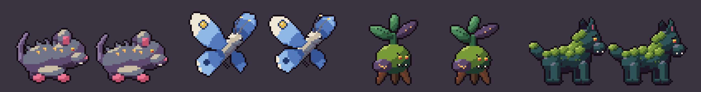
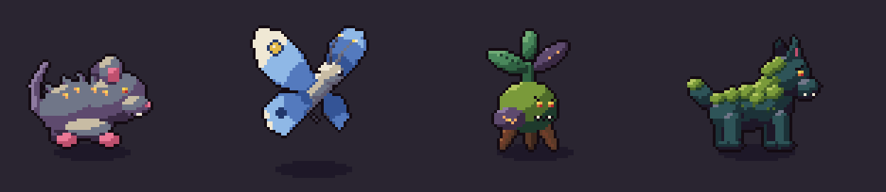
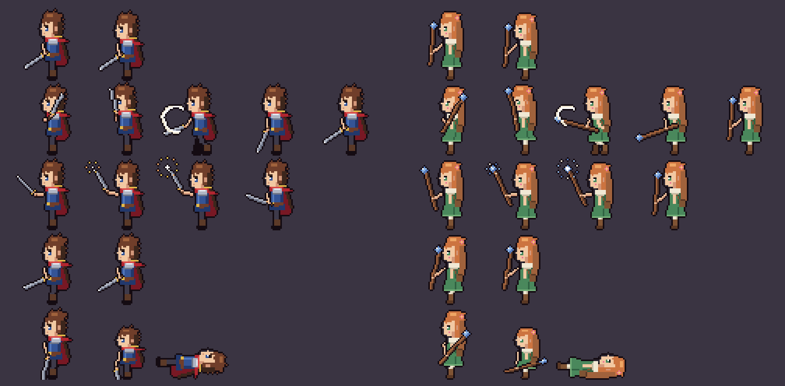
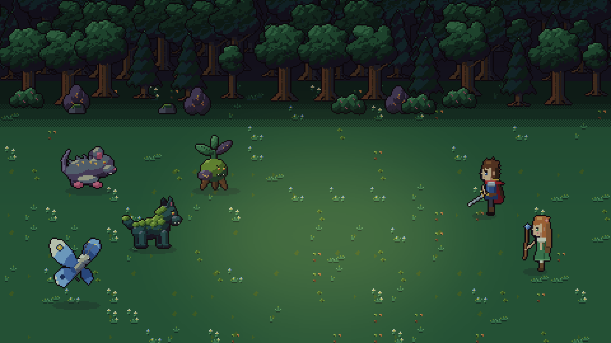
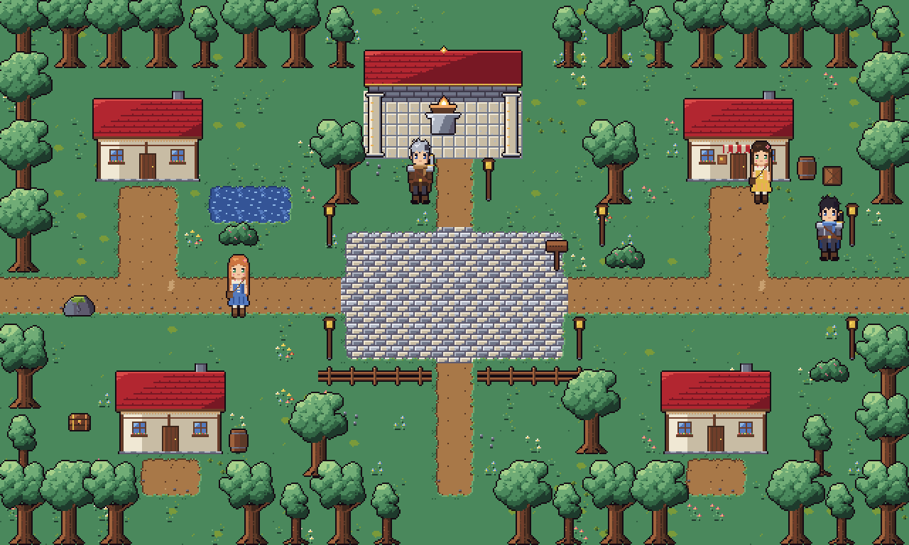

# Legend Heroes — Art Bible

Pedoman visual untuk semua art Chapter 1. Tujuannya satu: art dari siapa pun (Claude, asset pack, freelancer, kamu) terlihat seperti satu dunia yang sama dengan sprite Kael dan Lira.

## 1. Arah visual

- **Storybook hangat, sedikit murung.** Dunia yang indah tapi sedang "sakit" karena Ashblight. Warna hangat untuk rumah dan api, dingin untuk alam yang terancam.
- **HD-2D = sprite datar + kedalaman + cahaya.** Sprite dan tile tetap pixel art datar. Kesan 3D datang dari engine: lapisan parallax, y-sort, bayangan elips, cahaya multiply/additive, partikel, dan depth of field (lihat §9). Jangan menggambar efek cahaya ke dalam tile.
- **Keterbacaan di layar HP lebih penting daripada detail.** Siluet harus jelas di ukuran asli (1×) sebelum di-scale.

## 2. Resolusi dan grid

| Hal | Ukuran |
| --- | --- |
| Resolusi virtual | 480×270, integer scaling |
| Tile | 16×16 px |
| Sprite overworld (karakter, NPC) | 32×48 per frame, anchor di tengah kaki |
| Sprite battle party | 48×48 per frame, menghadap kiri |
| Musuh battle | 32×32 (kecil), 48×48 (normal), 64×64 (mini-boss), 96×96 (boss); menghadap kanan |
| Portrait dialog | 64×64 |
| Ikon UI (weakness, item) | 8×8 dan 16×16 |

Semua ukuran kelipatan 16 atau 8. Sprite boleh tidak memenuhi seluruh frame, tetapi kaki harus menempel di baris bawah frame.

## 3. Palet LH-48 (terkunci)

Semua art baru **hanya** memakai 48 warna di `tools/art/palette.py` (swatch: `docs/art/palette_lh48.png`). Palet ini disusun dari warna sheet Kael/Lira yang sudah ada.

| Ramp | Dipakai untuk |
| --- | --- |
| outline `#140B12` | Garis luar semua sprite dan prop. Jangan pernah pakai hitam murni. |
| night, stone | Bayangan malam, batu, logam, tambang |
| bark, dirt | Kayu, batang pohon, tanah, jalan |
| leaf, moss, teal | Hutan. Teal khusus untuk bayangan dalam di Whisperwood |
| blue, red, ember | Aksen karakter, api, bara, emas |
| cream, white, skin, pink | Kulit, kain terang, bunga, kilau mata |
| ash | Ashblight: tanaman/makhluk yang terjangkit (ungu keabu-abuan + retakan ember) |

**Aturan warna**

1. **Hue shifting.** Bayangan bergeser ke ungu/teal, highlight ke kuning hangat. Jangan cuma menggelapkan atau menerangkan warna yang sama.
2. **Maksimal 3–4 tingkat per material.** Misalnya daun: gelap `#1E3A2C` → tengah `#306242` → terang `#4A885C` → kilau `#70AC76`.
3. **Kontras tertinggi disimpan untuk yang penting.** Karakter, musuh, peti, dan objek interaktif lebih kontras dari tanah. Tanah memakai ramp yang rapat (kontras rendah) supaya tidak ramai.
4. **Tanpa anti-aliasing dan tanpa semi-transparan.** Alpha hanya 0 atau 255. Transparansi dan glow diatur engine.

## 4. Outline

- **Karakter, musuh, prop yang berdiri** (pohon, batu, peti, papan): outline 1 px `#140B12` di sisi luar.
- **Detail di dalam sprite:** pakai warna gelap dari ramp material yang sama (colored inner line), bukan outline hitam.
- **Tile tanah** (rumput, jalan, lantai): **tanpa outline.** Batas antar-material cukup dengan perubahan warna dan tepi bergerigi.
- **Kanopi pohon:** outline di sisi luar. Tepi yang menempel ke kanopi lain dibiarkan tanpa outline supaya pohon menyatu.

## 5. Cahaya dan volume

- **Sumber cahaya utama dari kiri atas.** Highlight di kiri atas benda, bayangan di kanan bawah.
- **Bentuk dibaca dari 3 zona:** terang (kiri atas), tengah, gelap (kanan bawah). Tambahkan 1–3 pixel kilau di zona terang untuk benda mengkilap.
- **Bayangan jatuh (cast shadow) digambar engine** sebagai elips, bukan di sprite.
- **Dithering boleh, tapi hemat:** hanya pola checker 50% di perbatasan dua tingkat warna pada permukaan besar (kanopi, tanah). Jangan dither sprite kecil.

## 6. Perspektif

- **3/4 top-down.** Permukaan atas benda terlihat, sisi depan juga terlihat.
- **Pohon hutan besar:** 3 tile lebar × 4 tile tinggi. Kanopi 3 baris atas digambar di layer foreground (di atas karakter). Baris bawah (batang dan akar) ada di layer decor dan menjadi collision.
- **Tinggi mata karakter sekitar 1,5 tile.** Pintu 1 tile lebar × 2 tile tinggi (baris dinding).

## 7. Animasi

| Aksi | Frame | Durasi per frame |
| --- | --- | --- |
| Idle overworld | 2 | 500 ms |
| Jalan | 4 | 140 ms (lari 90 ms) |
| Idle battle | 2–4 | 200–300 ms |
| Serang / skill | 4–6 | 60–100 ms, frame kontak ditahan 2× |
| Kena hit | 2 | 80 ms |
| KO | 3 | 120 ms, frame akhir ditahan |

Prinsip: antisipasi 1 frame sebelum serangan, dan squash/stretch maksimal 1 px.

## 8. Identitas area

| Area | Mood | Warna dominan | Aksen |
| --- | --- | --- | --- |
| Hollowmere | Hangat, aman | dirt, cream, leaf terang | ember (api kuil, lentera), red (atap) |
| Whisperwood | Teduh, misterius, mulai terjangkit | leaf gelap, teal, moss | ash (tanaman Ashblight), cahaya hangat tembus kanopi |
| Old Emberline Mine | Dingin, berat | stone, night | ember (kristal dan bara menyala) |
| Mine Depths (boss) | Panas, mengancam | night, red gelap | ember terang, ash |

## 9. Efek HD-2D (dikerjakan engine, bukan di art)

- **Lapisan:** ground → decor → karakter (y-sort) → foreground (kanopi, atap).
- **Cahaya:** overlay gelap multiply per area (hutan lebih gelap), plus sprite glow additive untuk api, lentera, kristal, dan berkas cahaya yang tembus kanopi.
- **Depth of field murah:** layer latar dan foreground yang di-blur di editor (bukan real-time).
- **Partikel:** bara di desa, daun jatuh dan spora Ashblight di hutan, debu di tambang.
- **Bloom dan vignette:** hanya di mode grafis Tinggi.

## 10. Format file

- PNG RGBA, alpha 0/255, **tanpa** color profile yang menggeser warna.
- **Tileset:** grid 16×16, 8 kolom per baris, tanpa jarak antar-tile. Urutan nama tile disimpan di `<area>_tiles.json` di samping PNG-nya.
- **Tanah dua layer:** tile dasar opak (varian warna rumput, jalan) di layer ground, lalu tile dekorasi transparan (rumput, bunga, semanggi, ranting) di layer decor. Dengan begitu, dekorasi bisa dipasang di atas varian tanah mana pun.
- **Varian tanpa jahitan:** semua varian satu material memakai tepi tile yang identik; perbedaannya hanya di bagian tengah. Karena itu, varian mana pun bisa bersebelahan dengan varian lain.
- **Prop** (pohon, batu, semak, batang tumbang, papan): **bukan tile**, tetapi sprite yang di-y-sort seperti karakter, supaya karakter bisa berdiri di depan maupun di belakangnya. Sheet `assets/images/props/<area>_props.png` + `assets/data/props_<area>.json` (frame + kotak collision relatif ke titik dasar).
- **Tepi jalan:** 13 tile autotile (tengah, 4 sisi, 4 sudut luar, 4 sudut dalam), dipilih otomatis oleh `tools/art/autotile.py`.
- **Sprite sheet:** satu baris per arah atau animasi, kolom per frame. Urutan arah: bawah, kiri, kanan, atas (sama seperti sheet Kael/Lira).
- **Nama file:** `snake_case`, contoh `whisperwood_tiles.png`, `ashen_rat_battle.png`.
- **Cek palet otomatis:** `python3 tools/art/check_palette.py <file.png>` menolak warna di luar LH-48.

## 11. Contoh: Whisperwood

Dibuat dengan `tools/art/whisperwood.py` (tile + prop) dan dicek dalam adegan dengan `tools/art/mock_scene.py`. Mock ini juga mensimulasikan bagian engine dari §9, yaitu bayangan elips, overlay hutan, berkas cahaya hangat, dan vignette. Dengan `--flat`, mock menampilkan art mentahnya saja.

Sprite battle 4 musuh Whisperwood (Ashen Rat, Wisp Moth, Blight Sprout, Moss Wolf) dibuat dengan `tools/art/enemies.py`. Semuanya berukuran 48×48 dan menghadap kanan. Sheet-nya berisi satu baris per animasi: idle 2 frame, serang 5 frame (antisipasi, maju, kontak ditahan 2×, mundur, kembali), kena hit 2 frame, dan KO 3 frame.

Frame hanya menyimpan pose. Seberapa jauh musuh maju, terpental, atau jatuh ditulis sebagai `offsets` di `<id>_battle.json`, bersama durasi tiap frame, lalu diterapkan engine ke posisi sprite. Efek kilat putih saat kena hit dan fade saat KO juga dikerjakan engine.

Adegan battle dicek dengan `tools/art/battle_mock.py`; party di mock ini masih memakai frame overworld. Animasinya bisa dilihat lewat `tools/art/anim_preview.py`.

Sprite battle party dibuat dengan `tools/art/party.py`. Badan Kael dan Lira diambil dari baris menghadap-kiri sheet overworld mereka, lalu warnanya dikunci ke LH-48 (warna hampir hitam menjadi warna outline). Senjata digambar per pose di layer terpisah dan diberi outline sendiri, begitu juga lengan yang menjulur keluar badan. Tebasan dan cahaya cast ditambahkan di atasnya.

Sheet party berisi baris idle, attack, cast, hit, dan KO. Frame terakhir KO memperlihatkan karakter terbaring. Offset di JSON memakai koordinat layar (x negatif berarti maju ke arah musuh), dan `shadowX` menaruh bayangan tepat di bawah kaki.

Peti (`assets/images/props/chest.png`, tertutup dan terbuka) dibuat dengan `tools/art/objects.py`. Backdrop battle (`assets/images/backdrops/whisperwood.png`) dibuat dengan `tools/art/backdrop.py` dari tile dan prop Whisperwood. Kedalamannya didapat dengan menurunkan tiap warna satu tingkat di ramp-nya, bukan dengan tint, jadi gambar tetap terkunci ke palet. Backdrop ini bisa diulang ke samping.

## 11b. Contoh: Hollowmere

Dibuat dengan `tools/art/hollowmere.py`. Rumputnya lebih terang dan hangat daripada hutan. Tileset-nya berisi jalan tanah, alun-alun berlapis batu, dan kolam, masing-masing dengan 13 tile tepi rumput dari `path_tile` yang sama dengan Whisperwood, ditambah lantai kuil dan pagar.

Rumah, toko, kuil (atap dan dinding belakang, pilar, altar bara), pohon desa, lentera, tong, dan peti kayu dibuat sebagai prop yang di-y-sort. Prop yang memancarkan cahaya (lentera, altar, Ashblight) menyimpan `glow` di JSON-nya, dan engine menggambarnya sebagai cahaya additive.

NPC sementara dibuat dengan palette swap dari sheet Kael atau Lira (`tools/art/npcs.py`). Ramp warnanya ditukar per indeks, dan aturan swap bisa dibatasi ke bagian kepala supaya rambut berubah sementara sepatu tetap. `tools/maps/preview.py` me-render peta mana pun beserta prop dan NPC-nya.

## 12. Boleh dan jangan

| Boleh | Jangan |
| --- | --- |
| Tepi organik bergerigi pada rumput dan jalan | Pola noise acak 1-pixel di seluruh tile (terlihat kotor) |
| Motif berulang yang divariasikan (2–3 varian tile tanah) | Satu tile tanah diulang tanpa variasi |
| Kontras tinggi hanya untuk hal yang bisa diinteraksi | Tanah lebih mencolok dari karakter |
| Siluet sederhana dan mudah dikenali | Detail lebih kecil dari 2 px yang hilang saat bergerak |
| Warna Ashblight (ash + retakan ember) untuk hal yang terjangkit | Memakai ungu ash untuk hal yang sehat |
